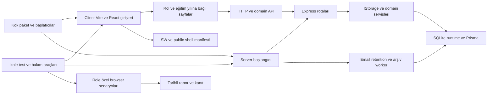

# QuizMaster refactor ve temizlik yol haritası

Durum: **İnceleme ve öneri; uygulama için kullanıcı onayı bekleniyor.** 14 Ekim 2026. Bu turda Graphify yenilemesi ve plan/envanter üretimi yapılır; uygulama kaynakları değiştirilmez, dosya silinmez, kurulum veya uygulama testi çalıştırılmaz.

## Amaç ve yaklaşım

Frontend, backend, kök yapılandırmalar, kurulum/bakım araçları, testler ve belgeler arasındaki sorumlulukları açıklaştırmak; tekrarları azaltmak; yalnız kullanılmadığı kanıtlanan kaynakları kaldırmak. Mevcut URL, rol, veri, API, sınav, arşiv ve çevrimdışı davranışları korunur.

| Yaklaşım | Kapsam ve maliyet |
|---|---|
| **Önerilen: iş alanlarına göre aşamalı refactor** | Küçük değişiklik grupları, geçici uyumluluk arayüzleri ve her aşamada ilgili doğrulama; büyük dosyaların sorumluluklarını da düzeltir. |
| Yalnız kullanılmayan kaynakları ve tekrarları temizleme | Daha kısa başlangıç; storage/API/ekran sorumluluklarının ayrıştırılmasını sonraya bırakır. |

Önerilen yaklaşımda tüm dosyaları topluca yeniden adlandırma, framework değişimi, yeni veritabanına geçiş veya API sözleşmesi değişikliği yapılmaz. Dizin sınırı iş alanı ve bağımlılık yönüyle birlikte değerlendirilir; bir dosyanın büyük olması tek başına hata veya silme gerekçesi değildir.

## İnceleme kapsamı ve sınırlar

Kaynak/config/komut/test dosyaları dosya bazında envantere alınır; boyut, satır sayısı, import/çağrı ilişkisi ve bağlı giriş noktalarıyla değerlendirilir. Graphify AST çıkarımı bu envanteri destekler. [Dosya bazında envanter](refactor-dosya-envanteri.json) her dosyanın türünü, boyut/satır sayısını, grafik komşularını ve belge atıflarını içerir. Ana Graphify grafiği yönsüzdür; komşuluk, tek başına import veya runtime çağrı yönü değildir. Görsel/PDF/ZIP/JSON kanıtları dosya ve rapor bağlantıları üzerinden sınıflanır; bütün içerikleri yeniden test edilmez. Bağımlılık paketlerinin kaynakları ve özel veriler uygulama kaynağı gibi satır satır taranmaz.

İlk envanter 1.470 depo veya Git dışı kaynak/kanıt dosyası, 508 kod/yapılandırma adayı içeriyordu: client 191, server 197, scripts 92, tests-e2e 48, docs 925, tools 1 ve kökte 16 dosya. Bunlar inceleme başlangıcının fotoğrafıdır. İnceleme sırasında mevcut başka çalışmalar yeni dosyalar ve değişiklikler üretti; son envanterin kendi sayımı ayrıca tutulur.

Özellikle `api.ts`, `server-setup.tsx`, `settings.tsx`, `results.tsx`, `storage.ts`, paket manifestleri ve yeni dashboard/bildirim/results-summary/SQLite çalışma dosyaları mevcut iş olarak korunur. Devam eden kapasite çalışmasının sonuçları bu refactor içine karıştırılmaz. Canlı `.env`, DB, oturum, yükleme ve yedek içerikleri açılıp kopyalanmaz; canlı DB yalnız SHA-256 koruma kontrolüne dahildir.

## Graphify kontrolü ve yenilemesi — 14 Ekim 2026

İlk kaynak/manifest karşılaştırmasında 11 değişmiş dosya ve 21 yeni kod dosyası bulundu; iki BAT giriş noktası AST kapsamı dışında kaldı. Eski belgelerin beş yolu da önceki manifestte vardı. Gerçek Graphify CLI ile önce tam, sonra inceleme sırasında değişen kaynaklar için artımlı güncelleme yapıldı; iki komut da çıkış 0 verdi.

Son harita **3.806 düğüm, 9.855 kenar, 207 topluluk** içerir. Resmî multigraph tanısında eksik/dangling/dış uç ve exact duplicate kenar 0; 28 self-loop vardır. Son seçili kaynak kontrolünde **503 içerik özeti diskle eşleşti**, eski kalan hash veya manifest dışında kaynak bulunmadı. Sayı ve komşuluklar [dosya envanterine](refactor-dosya-envanteri.json) işlendi. Graphify hub sorgusu PrismaStorage/IStorage, ortak API ve DashboardLayout gibi değişiklik etkisi yüksek sınırları destekler; bağlantı derecesi çalışma zamanı çağrı sayısı veya performans maliyeti değildir.

23 migration SQL dosyası tree_sitter_sql olmadığı için AST grafiğine katkı vermedi. Graphify ortamında pypdf yoktur; PDF metni çıkarılmadı. CSS, BAT ve örnek env/config gibi desteklenmeyen kaynaklar manuel yapılandırma/giriş incelemesiyle ele alındı. Belge/görsel semantiği ve LLM topluluk etiketleri yenilenmedi; iki kod güncellemesi harita/HTML/rapor üretti. Ana grafik yönsüzdür; komşuluk import/runtime yönünün yerine geçmez.

Çalışma ağacı inceleme sırasında başka mevcut çalışmalarla değişti; bu kontrol son doğrulama anının fotoğrafıdır. Uygulama başlangıcında tekrar eşleştirme gerekir. Bu turda test/build/uygulama/migration çalıştırılmadı; canlı DB ve korunmuş iki kullanıcı dosyasının başlangıç SHA-256 değerleri aynı kaldı. Refactor ve silme başlamadı; kullanıcı onayı bekleniyor.

## Ana bağımlılık akışları

Bu çizim mantıksal akıştır. Graphify'nin bütün kenarlarının gerçek çalışma zamanında bu sırayla yürüdüğü iddia edilmez. SQL trigger, public asset, yerel saklama anahtarı, HTTP uç noktası ve CLI kullanımını yalnız import grafiği kanıtlayamaz.

## 0. Başlangıç ve koruma

- Onay sonrasında Git dalı/HEAD, mevcut staged/unstaged değişiklikler ve kaynak/korunan dosya özetlerini kaydet. Devam eden işlerin son durumuyla plan/envanteri eşleştir.
- Kullanıcı diff'ini reset, stash, toplu formatlama veya otomatik yeniden üretimle ezme. Uygulama için mevcut değişiklikleri koruyan izole çalışma alanı değerlendir; gizli ayar ve canlı veriyi taşıma.
- Rol, HTTP, CSRF, session, Socket, akademik yıl, arşiv ve offline davranışlarını sözleşme listesine bağla. Yeni işlev veya kapasite deneyi ekleme.
- Ağır build/test/browser/fixture işlerini sırayla çalıştır. Her testin canlı yerine kendi verisini, portunu ve süreçlerini kullandığını komuttan önce kontrol et.

## 1. Kök dizin ve komutlar

`package.json`, workspace/lock, TypeScript ve Playwright girişleri; `kurulum.bat`, `kurulum.sh`, `start-local.ps1`, `.gitignore`, `.gitattributes`, `.editorconfig` birlikte değerlendirilir.

- Genel Playwright keşfini smoke ve özel runtime gerektiren audit/archive senaryolarından açık ayır. Mevcut genel config tüm `tests-e2e` dizinini seçiyor; akademik config ise runtime olmadan bilinçli reddediyor.
- Güvenli unit/guard test komutları ile migration/browser yapan ağır komutları ayrı isimlerle belgele. Bütün script testlerini wildcard ile körlemesine çalıştırma.
- `install-all` içindeki tekrarlanan workspace kurulumunun gerekli olup olmadığını kanıtla; paket/lock tutarlılığını koru.
- Kullanılmayan `path` importu ve aynı değere dönen `workers` koşulu gibi küçük sadeleştirmeleri ayrı yap.
- BAT/SH/PowerShell girişlerini silme: platform, Node seçimi, port ve süreç davranışları farklı. Kök başlatıcıdan sihirbaz/servis/build'e giden zinciri koru.

**Kabul:** komut keşfi doğru grupları seçer; özel audit fixture'ları genel smoke tarafından yanlış başlatılmaz; kurulum/bakım regresyonları ve iki platformun ilgili başlatıcı kontrolleri korunur.

## 2. Frontend — client

| Alt alan | Planlanan işlem | Korunacak bağ |
|---|---|---|
| `main.tsx`, `App.tsx`, context | Başlangıç, route/guard ve sağlayıcı sorumluluklarını açık tut; yalnız gerektiğinde küçük modüllere ayır. | Rol, lazy import, eski URL aliasları, returnUrl, base path, akademik yıl ve çok sekmeli bağlam. |
| `lib/api.ts` | HTTP/CSRF/error taşımasını domain API modüllerinden ayır; mevcut API dışa aktarımlarını geçiş boyunca facade olarak koru. | CSRF tek tekrar, credentials, AbortSignal, hata mesajı, cache ve mevcut kullanıcı değişiklikleri. |
| `pages/admin-management.tsx` | Ders/sınıf/kullanıcı CRUD, log/e-posta/parola işlemleri ve dialogları iş alanlarına ayır. | URL sekmeleri, sorgu anahtarları, sayfalama, audit ve odak geri dönüşü. |
| `components/management`, hooks | Mevcut form/tablo bileşenleriyle ekran içindeki tekrarı ortak hooks ve küçük view parçalarında topla. | Rol bazlı alanlar, sınıf numarası, veli bağlantısı, kapasite ve hata/boş ayrımı. |
| `pages/results`, `student-results`, `settings` | Saf hesap/filtre/çıktı ve veri yükleme sorumluluklarını ayır; devam eden summary/tercih çalışmasını önce mevcut durumuyla koru. | İstek yarışı, sıfır/null puan, tüm filtrelenmiş çıktı ve rol sınırı. |
| Layout ve CSS | Menü, bildirim ve responsive görünümü ayır; tema ve print CSS tekrarlarını ölçerek sadeleştir. | Klavye, mobil, bildirim cache'i ve gerçek baskı görünümü. |
| Quiz/editor ve offline lib | Son aşamada oturum/cevap uzlaştırma, senkronizasyon ve soru sunumunu ayır. | Cevap revizyonu, teslim kuyruğu, idempotency, süre, logout ve kullanıcı kimliği. |
| UI kataloğu ve public/config | Erişilmeyen UI kümelerini, paket tüketicilerini ve public metadata'yı birlikte doğrula. | SW, favicon, app-shell manifesti, Vite proxy, eager öğrenci yolu ve doğrudan public URL. |
| Testler | Mevcut davranış testlerini ilgili modül sınırına bağla; taşınan uygulamayı tekrar eden test ekleme. | Gerçek davranışı doğrulayan cache, yetki, offline, çıktı ve hata senaryoları. |

Öne çıkan anlık büyüklükler: admin-management 1.396, api 1.261, settings 730, student-results 670, student-quiz 647, results 603, DashboardLayout 458 satır. Önce API ve yönetim alanı; offline sınav motoru en son ele alınır.

## 3. Backend — server

| Alt alan | Planlanan işlem | Korunacak bağ |
|---|---|---|
| `index.ts`, routes/static/socket | Uygulama oluşturmayı runtime başlatma ve worker yaşam döngüsünden ayır. | Middleware sırası, HTTP/Socket ortak session, CSRF, context, graceful stop. |
| `storage.ts` | Yaklaşık 1.931 satırlık veri erişimini users/classes, content, results ve operations domain'lerine aşamalı çıkar; `IStorage` sözleşmesini koru. | Atomik yazma, kapasite, numara rezervasyonu, içerik/sonuç/audit tutarlılığı ve güncel çıkarılmış servisler. |
| `api-routes` | Kullanıcı, anket ve AI handler'larında doğrulama, erişim, orkestrasyon ve sunumu ayır. | Mevcut HTTP/status/body; ortak content-save; rol/yıl ve sınıf yetkisi. |
| `services` | Mevcut arşiv parçalanmasını koru; export/doğrulama ve ortak güvenli sunum yardımcılarını dar sınırlarla incele. | Capture/finalize transaction, checksum, lease, ownership, retry, recovery ve değişmez kaynak. |
| `middleware` | Policy sorumluluklarını belirginleştir; sırf benzer görünmeleri nedeniyle guard'ları birleştirme. | API ve DB'nin farklı koruma katmanları; audit ve işletim istisnaları. |
| `utils` | Email transport/config/queue ve deployment schema/effective config/artifact parçalarını ayır; JSON mapper'larını tipli hale getir. | Gizli alan temizleme, dış URL güvenliği, Prisma/client yaşam döngüsü ve farklı retry sözleşmeleri. |
| `setup-wizard` | Router/güvenlik, apply orkestrasyonu, sağlık/start ve HTML view parçalarını ayır. | `.env`, lock, migration, ilk admin, rollback ve port davranışı. |
| `prisma` | Model, ilişki, indeks ve trigger sahipliğini belgele. | Uygulanmış migration'ları silme, birleştirme veya yeniden adlandırma yok. Schema değişikliği bu refactorun amacı değil. |
| Test ve config | Ortak sade Vitest ayarlarını factory ile paylaş; unit ve migration/fixture içeren config'leri ayrı tut. | Config importunun DB oluşturabilmesi, native runtime, pristine fixture, teardown ve özel test bütçeleri. |
| `data`, `backups`, `uploads`, `node_modules` | İşlev ve sahiplik sınırını koru. | Canlı veriler, arşivler, medya, oturumlar ve gizli yedekler temizleme kapsamı dışındadır. |

`writeTransaction` ile tercih yazımının transient retry kodları benzer olsa bile bekleme/commit belirsizliği farklıdır; tek genel helper'a körlemesine taşınmaz. Yeni SQLite/session düzeninde eski sqlite3 bağlantısını kullanan testler vardır; `connect-sqlite3` paketinin artık üretimde kullanılmaması tek başına kaldırma kanıtı değildir.

## 4. scripts

- Kurulum/bakım araçlarında durum tespiti, doğrulanmış yedek, HTTP güvenliği, süreç yönetimi ve UI parçalarını ayır. Büyük `admin-hybrid-setup-closure.mjs` doğrudan test ve Linux hazırlama tüketicilerine sahiptir; silme adayı değildir.
- Teacher/student/parent runner'larının ortak launch/readiness/cleanup/report akışını ortak motor ve role/platform adaptörlerine çıkar.
- Teacher/student sanitizer ortak çekirdeğini role politikalarından ayır. Parent'ın öğrenci sanitizer'ını kullanmasını açık bağımlılığa dönüştür.
- PID/start identity, symlink/realpath, inode/dev, atomik `wx` yazma, port kapanışı ve fixture kimliği korumalarını aynen tut.
- CLI, koşullu subprocess ve doküman bağlantısı olan integration/performance araçlarını import eksikliği gerekçesiyle silme. Yeni kapasite/SQLite inceleme araçlarını koru.

**Kabul:** ilgili guard/redaction/sanitizer/owned-process birim testleri; değişen role ait bir yeni izole koşu; hassas kanıtların temizlenmesi ve yalnız sahipli süreç/port/dizin temizliği.

## 5. tests-e2e

- 48 kaynak dosyasının 44 spec ve 4 helper ayrımını koru. Genel smoke, role audit, academic lifecycle ve ağır kurulum senaryolarını açık gruplara ayır.
- Admin spec'lerindeki runtime/login/CSRF/API tekrarını `admin-audit-helpers` sorumluluğunda topla.
- Teacher ile student/parent helper'larının API argüman sırası farklıdır; ortaklaştırmada çağrı yerlerini tek tek dönüştür ve doğrula.
- Varsayılan config'in canlı veya eski servisi tekrar kullanmasına güvenme; izolasyon isteyen senaryolar kendi runtime/port/DB/süreç sözleşmesiyle yürüsün.
- Farklı katman/rol/hata durumunu doğrulayan benzer isimli testleri tekrar sanıp silme.

## 6. docs, tools, graphify-out ve dist

| Dizin | İşlem |
|---|---|
| `docs` | Ana README ve mevcut Türkçe kılavuz yapısını koru. Her kaynak taşımasında belge/kanıt bağlantılarını güncelle. Tarihsel kabul ve başarısız ölçümler silinmez; eski test çıktısı yalnız atıf/saklama ilişkisi kanıtlandıysa temizlik listesine girer. |
| `tools/mailpit` | Launcher ile binary ayrımını koru. Sadece port tutan PID'nin Mailpit olduğu varsayımını sahiplik doğrulamasıyla incele. Araç yerel e-posta denemesinin girişidir; import yok diye silinmez. |
| `graphify-out` | Paylaşılan graph.json, graph.html ve raporu kaynak değişikliklerinden sonra yenile. Yerel cache ve eski tarihli haritaları ayrı saklama politikasıyla değerlendir; grafikte görünmeyen dosyayı ölü sayma. |
| `dist`, `client/dist` | Yeniden üretilebilir build çıktılarıdır; çalışan servisin kullandığı dosyalar olabilir. Servis/işlem sahipliği ve yeni build kabulü olmadan silme. Kaynak refactoruyla aynı değişiklik listesinde karıştırma. |

`.git` korunur. `node_modules`, `.tmp-uv-cache` ve `.superpowers` kaynak refactoru değildir: sırasıyla bağımlılıklar, araç önbelleği ve özel çalışma/kanıt alanıdır. Kullanıcı veya çalışan süreç tarafından kullanılan altları toplu silinmez. Eski fixture temizliği, kernel süreç kimliği/port ve canonical yol doğrulaması yapılabilen ayrı bir temizlik işidir; canlı data dizininden genelleme yapılmaz.

## Silme adayı listesi ve kesinlik eşiği

| Aday | Mevcut kanıt | Silmeden önce gereken |
|---|---|---|
| `client/src/pages/admin/class-detail.tsx` | Tek satırlık üst düzey sayfa re-exportu; aktif rota farklı dosyayı kullanıyor. | Alias, lazy/test ve repo dışı uyumluluk kullanımı kalmadığının doğrulanması. |
| `client/src/lib/uuid.ts` | `generateUUID` tanımı dışında kaynak tüketicisi görülmedi. | Bütün giriş, test, script ve dolaylı kullanım kontrolü; ilgili derleme/test kabulü. |
| `client/src/components/layout/RoleSwitcher.tsx` | Tüketici görülmedi; boş açılır içerik. | Rol menüsü/manuel entegrasyon ihtiyacının olmadığı ve source closure kontrolü. |
| `queryClient.ts` içindeki `apiRequest` | Aktif ortak transport'tan ayrı, tüketici görülmeyen yardımcı. | Export kullanım kontrolü. Dosyanın aktif QueryClient/default GET işlevleri korunur. |
| Üretimden erişilmeyen UI bileşenleri | Bazı hazır katalog bileşenleri entry closure'da yok. | Test/tool/dinamik kullanım, bütün tüketici kümesi ve bağlı paketlerin birlikte kontrolü. |
| `server/vite.ts` | `setupVite` tanımı dışında tüketici görülmedi; eski kök vite config importu var. | Alternatif geliştirme/manuel başlangıç kullanımı ve build/typecheck sözleşmesi. |
| `server/check-users.ts` | Komut/import tüketicisi görülmedi; manuel DB teşhis aracı. | Operasyon ihtiyacı/sahipliği doğrulanmalı; mevcut canlı kullanıcı okuma komutu çalıştırılmaz. |
| `email.ts` içindeki `sendEmail` aliası | Tanım dışında tüketici görülmedi. | Tüm uygulama/test/CLI ve uyumluluk kullanımının kontrolü. |
| `public/opengraph.jpg`, Tailwind config ve paket adayları | Açık tüketici bulunmayan statik/config/paket adayları var. | Public URL, otomatik config keşfi, CSS/tema ve ilgili paket consumer closure kontrolü. |

Bu liste **kesin silme listesi değildir**. Şu aşamada tamamen işlevsiz olduğu kanıtlanıp silinmesine karar verilen kaynak dosyası yoktur. Kanıt yetersizse dosya korunur.

Bir silme için: girişler/import-export/lazy/CLI/subprocess/asset/config/test/README tüketicileri birlikte aranır; güvenlik, veri veya kabul kanıtı değeri olmadığı doğrulanır; ilgili doğrulama geçer; silinen dosya ve gerekçesi değişiklik kaydında tek tek yazılır. Kullanılmıyor görünen paket, kalan başka bir modülün gereksinimiyse kaldırılmaz. `recharts`, `next-themes` ve backend validation/legacy test paketleri özel dikkat gerektirir.

## Uygulama sırası ve her aşamanın kapanışı

1. Mevcut çalışma durumunu sabitle; sözleşme/envanter ve test girişlerini kesinleştir.
2. Kök test/komut keşfini ve düşük etkili küçük sadeleştirmeleri tamamla.
3. Kesinleşen düşük riskli kullanılmayan kaynakları küçük gruplarla kaldır.
4. Frontend HTTP/domain API, ardından admin yönetim ekranını ayır.
5. Backend storage/domain repository ve uygulama/runtime sınırlarını ayır.
6. Script sanitizer/runner ve E2E helper tekrarlarını ortaklaştır.
7. Sonuç/layout/stil ve kurulum/işletim modüllerini dar gruplarla düzenle.
8. Offline sınav, akademik context ve arşiv worker gibi yüksek riskli alanları yalnız faydası somut olduğu ölçüde en son ele al.
9. Belge/bağlantı/Graphify güncellemesi, izole son kabul ve temizlik manifestiyle kapat.

Her grup: mevcut davranışı ölçen uygun test → dar refactor → ilgili test ve typecheck → etkilediği build/browser/çıktı kabulü → diff ve koruma kontrolü. Her küçük grup ayrı geri alınabilir kaynak değişikliği olarak tutulur; dosya taşıma ve davranış değişikliği mümkün olduğunca ayrılır. Commit/push bu planın onayının ayrıca açıkça kapsadığı durumda yapılır; force push veya uzak main değişikliği yapılmaz.

Kapanışta doğrulanmamış kontrol başarılı sayılmaz. Refactor tamamlanması kapasite SLA'sı veya bütün olası hataların kapanması anlamına gelmez. Mevcut kapasite/SQLite deneyleri kendi rapor ve kaynak sahipliğinde kalır.

## Onay

Onay, bu aşamalı kaynak refactoru ve yalnız yukarıdaki kanıt eşiğini geçen temizliğin başlaması içindir. Canlı DB/veri/env/yedek silme veya üretim migration/dağıtımı bu onayın kapsamında değildir. Uygulama başlamadan önce bu planın güncel çalışma ağacıyla uyumu tekrar kontrol edilir.
