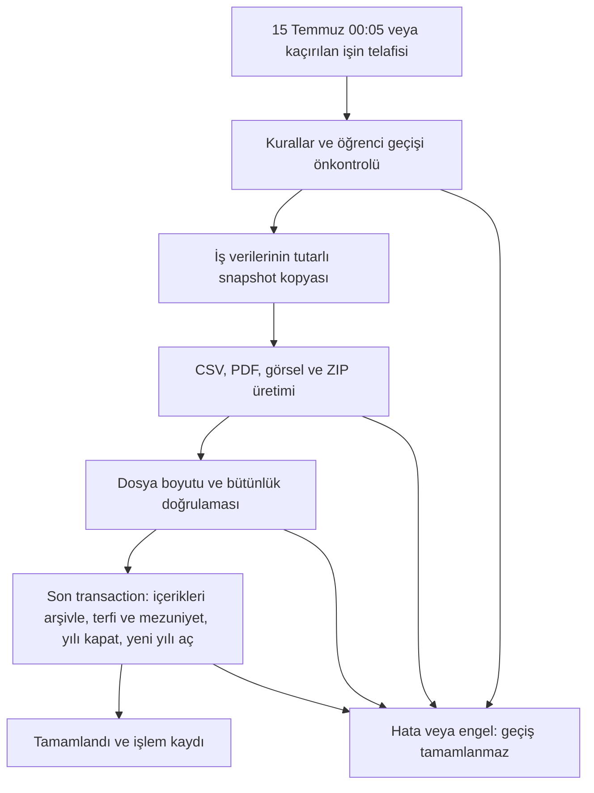

# Eğitim yılı geçişi ve arşivleme

Son kaynak ve belge kontrolü: 14 Ekim 2026. Bu kılavuz yöneticiye açık `/archive` sayfasını, yıllık işi ve geçmiş dönem görünümünü açıklar. Canlı sistemin bu tarihte yıl kapattığı anlamına gelmez; kabul sonuçları izole sentetik kurulumlardan gelir.

## İki işlem arasındaki fark

| Konu | Manuel arşiv | Yıllık arşiv ve geçiş |
|---|---|---|
| Kapsam | Yönetici tarafından seçilen sınav/anket ve ilişkili iş verileri | Kapanan eğitim yılının iş verileri |
| Başlatma | Yönetici seçimi ve ön izleme | İstanbul saatiyle 15 Temmuz 00:05; kaçırılırsa açılışta telafi |
| İçerik | Seçilen içerik arşivlenir; seçilmeyen içerik korunur | Kapanan yılın sınav/anketleri aktif kullanım ve listelerden ayrılır |
| Veri silme | Fiziksel silme yapılmaz | Fiziksel silme yapılmaz |
| Öğrenciler | Sınıf ve mezuniyet değişmez | Uygun aktif öğrenciler bir kez taşınır veya mezun edilir |
| Eğitim yılı | Açık kalır | Paket doğrulandıktan sonra kapanır, sonraki yıl aktif olur |
| Öğretmen atamaları | Korunur | Ders, sınıf ve şube bağlantıları korunur |

Manuel arşiv yalnız bir dosya kopyalama işlemi değildir: başarıyla tamamlanınca seçilen içerik arşiv statüsüne geçer ve düzenlemeye kapanır. Hesapları silmez veya öğrencileri taşımaz. Akademik paket, sunucunun tam geri yükleme yedeği değildir; oturum, parola ve gizli sunucu ayarlarını içermez. Tam yedek için [bakım kılavuzunu](production-maintenance.md) kullanın.

## Sayfaya erişim ve eğitim yılı seçimi

Yönetici menüsündeki **Arşiv** sayfasını aktif yıl seçiliyken açın. Sayfanın başlığı **Yıl Sonu ve Arşiv İşlemleri** olarak gösterilir. Sol menünün üstündeki eğitim yılı seçicisinde aktif yıl ilk sıradadır. Yeni oturum aktif yılda başlar; aynı oturumda bilinçli seçilen geçmiş yıl, yenilemede korunur.

Tamamlanmış geçmiş yıl seçildiğinde yönetici çalışma alanı o yılın değişmez snapshot verilerini salt okunur gösterir. Geçmişte düzenleme, yeni kayıt veya silme yapılamaz; API tarafı da yazmayı reddeder. Geçmiş veriler bugünkü canlı kayıtlardan doldurulmaz. İşletim ekranları tarihî iş verisini temsil etmiyorsa kapsam açıklaması gösterir. Eski arşivin arama projeksiyonu hazırlanıyorsa bekleme ve yeniden deneme durumu görülebilir.

## 1. Manuel Arşiv sekmesi

1. Arşivlemek istediğiniz sınav ve anketlerin kutularını seçin.
2. Ön izlemenin yüklenmesini bekleyin. Seçilen içerik, sınav sonucu, anket yanıtı ve soru sayıları gösterilir. Ön izleme hatasında **Ön İzlemeyi Yenile** kullanılabilir; geçerli ön izleme olmadan başlatma açılamaz.
3. **Seçilenleri Arşivle** düğmesine basın. Sunucu seçimi ve aktif yılı yeniden doğrular; kalıcı bir arşiv işi oluşturur.
4. **İş İlerlemesi** veya **Geçmiş ve İşler** bölümünden işi izleyin. İşin kuyruğa alınması tamamlandığı anlamına gelmez.
5. **Tamamlandı** sonrasında **Arşivi İndir** ile yönetici parolanızı tekrar doğrulayın.

Seçim dışında kalan içerikler etkilenmez. Arşiv, ilgili soruların, sonuçların, yanıtların ve ilişkili iş kayıtlarının işlemde yakalanmış kopyasını korur. Yıl kapanışı veya öğrenci hareketi yapılmaz.

## 2. Sınıf Geçişi sekmesi

Yıllık kapanıştan önce açık geçiş kurallarını hazırlayın. Sistem sınıf adından hedef tahmin etmez.

1. Her uygun aktif öğrencisi bulunan kaynak sınıf için bir hedef sınıf veya **Mezuniyet** seçin. Örnek: `7/A → 8/A`, son sınıf `→ Mezuniyet`.
2. **Geçiş Kurallarını Kaydet** düğmesine basın. Kaydetmek öğrenciyi hemen taşımaz; kurallar yıllık işte uygulanır.
3. **Geçiş önkontrolü** bölümünü inceleyin. Önkontrol kaydedilmiş kuralları kullanır; kaydedilmemiş seçimler geçiş planına dahil değildir.
4. Eksik/geçersiz hedefi, kapasite aşımını veya öğrenci numarası sorununu giderip kaydedin; **Önkontrolü Yenile** ile tekrar kontrol edin.

Önkontrol ve son veritabanı geçişi aynı planlama kurallarını kullanır. Son aşamada yeniden doğrulama yapılır. Her öğrencinin hedefi başlangıç üyeliğinden hesaplanır; `7/A → 8/A → 9/A` zincirinde öğrenci aynı işlemde iki kez ilerlemez. Hedef sınıf numaraları sistem tarafından benzersiz atanır; elle numara seçilmez. Kapasite aktif öğrenciler üzerinden denetlenir, numara rezervasyonu mevcut kayıtları da dikkate alır.

Önceden pasif öğrenciler, önceki mezunlar ve sınıfsız öğrenciler otomatik taşınmaz. Son sınıfın uygun aktif öğrencisi mezuniyet yılı/tarihiyle pasife alınır; sınıf ve öğrenci numarası boşaltılır, hesap ve geçmiş sonuçları korunur. Öğretmen ilişkileri değiştirilmez.

İşin veri yakalama/üretim/doğrulama aşamalarında kurallar kilitlenebilir; devam eden işin planı serbestçe değiştirilemez. Tamamlanınca **Tamamlanan sınıf geçişi** bölümünde terfi, mezuniyet ve korunarak atlanan kayıt sayıları gösterilir. Kurallar sonraki yıla aktarılır; yeni yıl için yeniden gözden geçirilmelidir. Eski snapshot'ta geçiş özeti bulunmuyorsa ekran bunu açıklar.

## 3. Yıl Sonu sekmesi

Bu sekme kapanış zamanını, önkontrol gereksinimini ve yıllık işi engelleyen manuel işleri gösterir. **Eğitim Yılını Kapat** işlemi tarih sınırından önce kullanılamaz; kayıtlı kuralların geçerli olması gerekir. Otomatik worker da aynı önkontrolü uygular.

Kapanış sırası:

Veri kopyalama, dosya üretimi ve son geçiş ayrı aşamalardır. Dosya üretimi uzun veritabanı transaction'ının içinde yapılmaz. Snapshot sonrası yıllık iş verisi sınırı API ve DB korumalarıyla tutulur. Kimlik doğrulama/parola kurtarma gibi izinli işletim işlemleri devam edebilir.

Paket doğrulanmadan terfi, mezuniyet veya yıl aktivasyonu yapılmaz. Son transaction başarısızsa onun içerik/öğrenci/yıl değişiklikleri birlikte geri alınır. Başarısız işin daha önce yakalanmış snapshot'ı tanı ve kurtarma için korunur; bütün önceki aşamalar silinmez. Yıllık iş kimliği, lease/sahiplik ve durum kontrolleri aynı yılın tekrar kapanmasını veya öğrencinin yeniden atlatılmasını önler.

Sunucu kapalıysa kalıcı aktif yıl kaydından kaçırılan kapanış bulunur. Worker açılışta ve periyodik olarak iş arar. Kurulumdan önceki yıllara sahte snapshot üretilmez. Tamamlanmamış manuel iş yıllık kapanışı engelleyebilir; ekran iş kimliğini, nedenini ve çözümünü gösterir.

## 4. Geçmiş ve İşler sekmesi

Tamamlanan eğitim yılları ve sayfalanan arşiv işleri listelenir. Her iş için yıl, manuel/yıllık türü, iş kimliği, oluşturma zamanı, bu döngüdeki ve toplam deneme sayısı, yönetici kurtarma sayısı ve varsa hata gösterilir.

| Görünen durum | Anlamı |
|---|---|
| Sırada | İş kaydedildi, çalışmayı bekliyor |
| Veriler kopyalanıyor | Snapshot yakalanıyor |
| Dosyalar hazırlanıyor | Dondurulmuş kaynaklardan paket üretiliyor |
| Dosyalar doğrulandı | Paket geçti; son DB geçişinin bitmesi bekleniyor |
| Tamamlandı | Son geçiş ve iş kaydı tamamlandı; indirme açılır |
| Yeniden deneme bekleniyor | Geçici hata sonrası sınırlı otomatik tekrar bekleniyor |
| Başarısız | Deneme döngüsü başarısız; neden giderilip yönetici kurtarması gerekir |
| Kopyalama başlamadan iptal edildi | İptal koşulları sağlanan manuel iş sonlandırıldı |

**İlerleme ve Kayıtlar** seçilen işin durumunu ve işlem kayıtlarını açar. **Yeniden Dene**, başarısız işte aynı dondurulmuş verilerle yeni sınırlı deneme döngüsü başlatır; öğrenci tekrar taşınmaz. Bozuk tamamlanmamış paket kurtarmada karantinaya alınabilir. Aktif lease varken kurtarma yapılamaz. **Kopyalama başlamadan iptal**, yalnız henüz capture yapılmamış, lease'i olmayan başarısız manuel işte sunulur; yıllık işi veya tamamlanan arşivi silme düğmesi değildir.

Tamamlanmış snapshot değişmezdir. Başarısız yıllık iş yönetici bildirimi ve e-posta Outbox kaydı üretebilir; SMTP teslimi ayrı işletim sürecidir.

## İndirme ve paket içeriği

**Arşivi İndir → Yönetici şifresi → Şifreyi Doğrula ve İndir** sırasını kullanın. Parola onayı beş dakika geçerli, yönetici ve mevcut oturumla sınırlı indirme izni oluşturur; başka oturumdan aynı izin kullanılamaz. Paket bütünlüğü indirme sırasında da kontrol edilir. Bozuk dosya başarılı indirme sayılmaz.

Paket sunucuda `backup_root/{academicYear}/{snapshotId}/` altında tutulur. ZIP; dört CSV grubu, `records.json`, `meta.json`, `index.json`, PDF raporu/parçaları, desteklenen dondurulmuş yerel görseller ve manifest/checksum dosyaları içerir. Sınıf/şube → ders → sınav/anket erişimi indeksle eşlenir; her sınavın fiziksel olarak ayrı klasörde PDF'si bulunduğu varsayılmamalıdır. Dosya başına SHA-256 ve boyut, ZIP özeti ise DB'de tutulur.

Görsel türleri, uzak görsel sınırlaması, PDF parçalama ve 64 MiB snapshot / 256 MiB paket sınırları [paket sözleşmesinde](academic-archive-review/artifacts.md) açıklanır. CSV/PDF'ler dönem iş verisidir; tam sunucu kurtarması için ayrıca [yedek/restore](production-maintenance.md) gerekir.

## Yapılan geliştirmeler ve kabul kanıtı

| Tamamlanan iş | Commit / kanıt |
|---|---|
| Eğitim yılı, kalıcı iş ve geçiş modeli | `3070f53` |
| Değişmez snapshot ve korumalı export | `d1999f0`, `71b2905` |
| Yıllık otomasyon ve arşiv yönetici ekranı | `12fbc66`, `648e611` |
| Geçmiş kapsamı ve başarısız iş kurtarma | `7ae258e`, `779a8c8` |
| API/DB yıllık sınırı ve geçiş önkontrolü | `8c1bbca`, `8bf9de8` |
| Eğitim yılı seçimi ve geçmiş çalışma alanı | `9d32cb4` |
| Paket, hacim ve son kabul | `48f88ba`, `df104eb` |
| Belgeler ve mimari harita kapanışı | `f44824a`, `074acf9`; üretim provası kapanışı `0a3bc1f` |

12 Ekim nihai akademik kabulü 74/74 gerçek DB/hacim, 27/27 dosya, 18/18 geçmiş ve 30/30 worker kontrolünü; beş ayrı manuel/geçmiş/sınır/kurtarma/geçiş Chromium senaryosunu kaydeder. [Nihai plan](superpowers/plans/2026-10-05-academic-archive-review-plan.md) ve [doğrulama raporu](academic-archive-review/verification.md) geçmiş başarısız denemeleri ve ölçüm sınırlarını da korur. Bu belge hazırlanırken ağır testler yeniden çalıştırılmadı; kaynak ve mevcut kayıtlar karşılaştırıldı.

14 Ekim genel performans ölçümündeki 20 aktör kapasite başarısızlığı ayrı açık konudur. Arşiv akışının kabulü, her yükte gecikmesiz çalışma veya canlı üretim SLA'sı garantisi değildir. [Performans sonucu](production-performance-results.md) ve [kapasite devam incelemesi](production-capacity-investigation-results.md) birlikte okunmalıdır.

Kaynaklar: [sayfa](../client/src/pages/admin/archive.tsx), [API](../server/api-routes/archive.ts), [worker](../server/services/archive-worker.ts), [geçiş planlayıcı](../server/services/archive-transition.ts), [zaman hesabı](../server/services/academic-year.ts).
